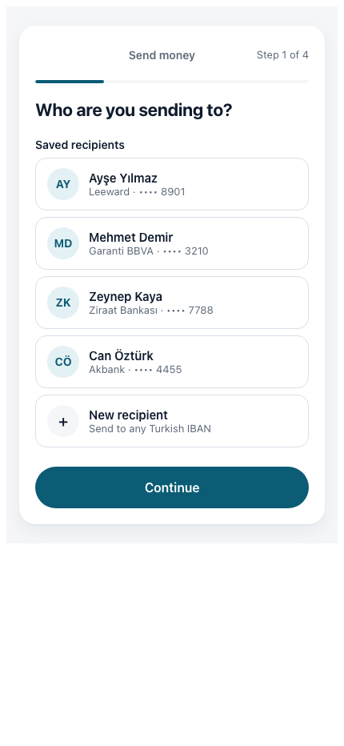

# Leeward Design System

<!-- DRAFT: headline needs Kemal's approval (PROJECT_BRIEF.md, section 7.2). -->
**An open-source, AI-ready design system for a fictional digital bank, built in 7 days.**

> Status: built, including the "same prompt, two results" demo.

<!-- Hero image or GIF of the docs site goes here. -->

## Why it exists

When an AI agent (Claude Code, Cursor or similar) generates a banking screen, how do you guarantee it is on-brand, accessible and consistent?

This repo answers with three layers: tokens and components that make the right thing easy, governance that makes the wrong thing fail in CI, and an agent layer that hands the rules to the agent before it writes code.

## The brand

Leeward is a fictional digital-only bank. It is not a real company. In sailing, the lee is the side of the ship sheltered from the wind. Leeward brings that idea to money: however rough the world gets, your money sits on the sheltered side.

*Steady money, whatever the weather.*

## Principles

| Principle | What it means | What it changes in the UI |
|---|---|---|
| **Clear over clever** | Plain language, no jargon | Labels describe outcomes. No icon-only actions for moving money. |
| **Honest numbers** | Amounts, fees and rates are never hidden or styled down | Amounts use tabular figures. Fees use the same text size as the amount they belong to. |
| **Calm confidence** | Money is stressful. The interface is not. | Restrained motion. Red only for real errors. Outgoing money is never red. |
| **Accessible by default** | Everyone can bank on their own | WCAG 2.2 AA minimum, APCA reported, 44px touch targets. |

## What is inside

| Area | What you get | Where |
|---|---|---|
| Tokens | Seed colors turned into OKLCH ramps where each step has a fixed contrast against white. 202 semantic tokens. Output as CSS variables, typed TS and Figma variables (DTCG). | [packages/tokens](packages/tokens) |
| Themes | Light and dark, plus partner themes generated from one color. | [ADR 0003](docs/decisions/0003-color-and-type.md), [ADR 0004](docs/decisions/0004-partner-themes.md) |
| Components | 20 core components (Text and Heading count as one, as in the brief): Button, IconButton, Text, Heading, Icon (43 icons), TextField, Select, Checkbox, RadioGroup, Switch, Badge, Chip, Avatar, Card, ListItem, Tabs, Dialog, Toast, Tooltip, Skeleton, ProgressBar. | [packages/react](packages/react/src/components) |
| Banking patterns | AmountDisplay, BalanceHeader, TransactionRow, AccountCard, OTPInput. | [packages/react](packages/react/src/patterns) |
| Governance | Contrast gate, ESLint and Stylelint rules, story tests with axe in three themes, visual regression, unit tests. | [packages/lint](packages/lint), [CI](.github/workflows/ci.yml) |
| Agent layer | [DESIGN.md](DESIGN.md), [llms.txt](llms.txt), [components.manifest.json](components.manifest.json) and an MCP server with five tools. | [packages/mcp-server](packages/mcp-server) |
| Demo | Same prompt, two results: an agent builds a transfer screen without and with the system. | [apps/demo](apps/demo) |

## Checks in CI, with current numbers

Every number here is printed by a script or test runner in this repo.

| Check | Result |
|---|---|
| Contrast gate (`pnpm contrast`) | 208 required pairs across light and dark, 0 failures against WCAG 2.2 AA. APCA reported in [docs/contrast-report.md](docs/contrast-report.md). |
| Partner themes | 200 random seed colors, every one passes all required pairs (property test). |
| Story tests with axe (`pnpm test:stories`) | 133 stories, each run in light, dark and the Harbor partner theme. 0 axe violations. |
| Unit tests (`pnpm test`) | 72 tests: React 50, MCP server 10, lint rules 6, tokens 6. |
| Visual regression | Every story screenshotted in light and dark with Playwright. |
| Lint (`pnpm lint`) | No raw colors, only known semantic tokens, spacing and type on scale, no icon-only money actions, no red amounts. |
| Copy (`pnpm check:copy`) | No em dashes in any tracked text file. |
| Freshness | CI fails if token outputs or agent docs are out of date with their sources. |

## Use it with an AI agent (MCP setup in 3 steps)

Requires Node.js 24 or newer.

1. Clone and install:

```bash
git clone https://github.com/kscarfi/leeward-design-system.git
```

```bash
cd leeward-design-system && corepack enable pnpm && pnpm install
```

2. Add the MCP server to Claude Code:

```bash
claude mcp add leeward -- node "$PWD/packages/mcp-server/src/index.ts"
```

3. Ask for a screen: "Build a money transfer screen with the Leeward design system. Check your code with validate_ui."

Tools: `get_tokens`, `get_component`, `search_components`, `get_guidelines`, `validate_ui`. Details in [packages/mcp-server](packages/mcp-server/README.md).

## Use it in an app

```tsx
import "@leeward/react/fonts.css";
import "@leeward/react/styles.css";
import { AmountDisplay, Button } from "@leeward/react";

<div data-theme="light">
  <AmountDisplay value={250} currency="TRY" locale="tr-TR" direction="outgoing" />
  <Button>Send ₺250</Button>
</div>
```

Themes: `data-theme="light"`, `"dark"` or `"auto"`. Generate a partner theme:

```bash
pnpm theme:generate --name harbor --seed "#0E7490"
```

## The demo: same prompt, two results

The prompt is fixed in [apps/demo/PROMPT.md](apps/demo/PROMPT.md). Run A has no design system. Run B has the MCP server. Outputs are saved unedited and measured by [apps/demo/scripts/compare.ts](apps/demo/scripts/compare.ts): raw colors, contrast failures, axe violations, invented components and lines of code.

Both runs used Claude Code 2.1.309 with `claude-opus-5-5`, headless, one attempt each, in a fresh empty folder with user settings and other MCP servers off. Run B called the Leeward MCP tools 27 times (`get_component` 18, `search_components` 5, `validate_ui` 2, `get_tokens` 1, `get_guidelines` 1). Full transcripts are in [apps/demo/runs](apps/demo/runs).

| Metric | A: without system | B: with system |
|---|---|---|
| Lines of code | 1384 | 1056 |
| Raw colors | 17 | 0 |
| Raw spacing values | 38 | 0 |
| Own CSS variables defined (a private palette) | 14 | 0 |
| Custom components invented | 10 | 2 |
| Leeward components used | 0 | 12 |
| Hand-formatted money | 0 | 1 |
| Em dashes in copy | 1 | 0 |
| axe violations | 0 | 0 |
| Color contrast failures (axe) | 0 | 0 |
| Rendered without runtime errors | Yes | Yes |

| Run A | Run B |
|---|---|
|  |  |

What this shows, and what it does not:

- **Accessibility was a tie.** The model without the system already produced a screen with 0 axe violations and 0 contrast failures. The system did not make Run B more accessible than a strong model on its own.
- **Brand and consistency were not.** Run A invented its own palette (14 CSS variables, 17 raw colors), 38 raw spacing values and 10 local components. None of it would match another screen built the same way. Run B used 12 Leeward components and no raw values, so it matches every other Leeward screen and changes with the theme.
- **Run B still made one mistake** the validator caught after the fact: it formatted an amount with `toFixed()` instead of `formatAmount()`.
- **Visual polish is a matter of taste here.** Run A's first step looks richer. Run B is plainer because it follows the system's restrained style.

Full report: [apps/demo/COMPARISON.md](apps/demo/COMPARISON.md).

## Develop

```bash
corepack enable pnpm
```

```bash
pnpm install
```

```bash
pnpm storybook
```

Other scripts: `pnpm build:tokens`, `pnpm build:agent`, `pnpm contrast`, `pnpm typecheck`, `pnpm lint`, `pnpm test`, `pnpm test:stories`.

## Repository layout

```
packages/
  tokens/       DTCG source, OKLCH ramps, Style Dictionary build, partner themes
  react/        Components and banking patterns
  lint/         ESLint and Stylelint governance rules
  mcp-server/   MCP server for AI agents
apps/
  docs/         Storybook, story tests, visual regression
  demo/         Same prompt, two results
scripts/        Contrast report, theme generator, manifest and agent docs builders
docs/
  build-log.md  Time log and AI mistakes
  decisions/    Architecture decision records
```

## Build log

Time spent and AI mistakes, with how each was caught: [docs/build-log.md](docs/build-log.md). The summary with total hours lands here once the time estimates are in.

## Toolchain

Claude Code, Figma, ColorsMine, Coverage Report, DesignOps.Tools.

## Credits

Designed and directed by Kemal Salih Carfi ([kscarfi.com](https://kscarfi.com), [LinkedIn](https://www.linkedin.com/in/kemalsalihcarfi/)). Built with Claude Code.

## License

[MIT](LICENSE)
