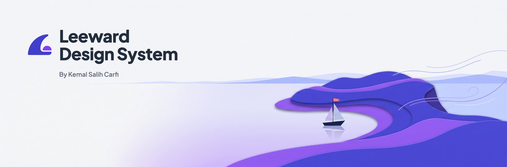
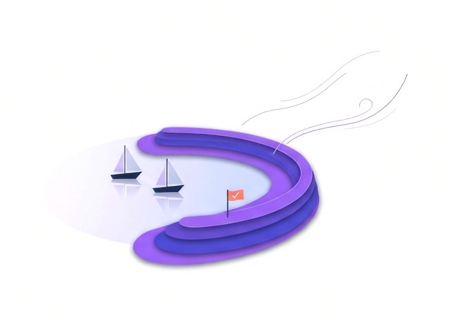
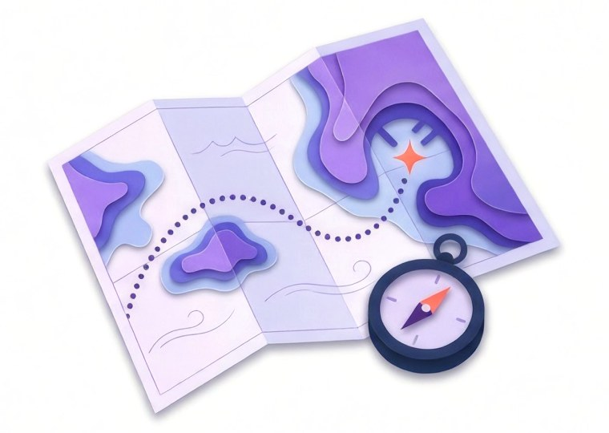
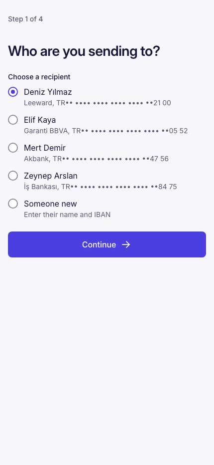

<h1 align="center">
  <picture>
    <source media="(prefers-color-scheme: dark)" srcset="docs/assets/readme/banner-dark.jpg">
    
  </picture>
</h1>

<p align="center">
  <a href="https://www.npmjs.com/package/@leeward/react"></a>
  <a href="https://github.com/kscarfi/leeward-design-system/actions/workflows/ci.yml"></a>
  
  <a href="LICENSE"></a>
</p>

<p align="center"><strong>An open-source, AI-ready design system for digital banking.</strong><br>Tokens, React components, banking patterns, lint rules and an MCP server, designed and directed by Kemal Salih Carfi.</p>

<p align="center">
  <a href="https://kscarfi.github.io/leeward-design-system/app/">Demo app</a> ·
  <a href="https://kscarfi.github.io/leeward-design-system/">Storybook</a> ·
  <a href="https://www.figma.com/community/file/1703881089318257135/leeward-design-system">Figma</a> ·
  <a href="#quick-start">Quick start</a> ·
  <a href="#use-it-with-an-ai-agent">AI agents</a> ·
  <a href="#whats-inside">What's inside</a> ·
  <a href="#quality-checks">Quality checks</a> ·
  <a href="#the-demo-same-prompt-two-results">Demo</a>
</p>

## Why it exists

When an AI agent (Claude Code, Cursor or similar) generates a banking screen, how do you guarantee it is on-brand, accessible and consistent? Leeward answers with three layers:

<table>
  <tr>
    <td width="33%" valign="top" align="center">
      <picture>
        <source media="(prefers-color-scheme: dark)" srcset="docs/assets/readme/s1-dark.jpg">
        
      </picture>
      <br><strong>Foundations and components</strong>
      <br>Tokens, components and banking patterns that make the right thing the easy thing.
    </td>
    <td width="33%" valign="top" align="center">
      <picture>
        <source media="(prefers-color-scheme: dark)" srcset="docs/assets/readme/s2-dark.jpg">
        
      </picture>
      <br><strong>Governance</strong>
      <br>Contrast, lint, accessibility and visual checks that make the wrong thing fail in CI.
    </td>
    <td width="33%" valign="top" align="center">
      <picture>
        <source media="(prefers-color-scheme: dark)" srcset="docs/assets/readme/s3-dark.jpg">
        
      </picture>
      <br><strong>Agent layer</strong>
      <br>AGENTS.md, DESIGN.md, llms.txt and an MCP server that hand the rules to an agent before it writes code.
    </td>
  </tr>
</table>

## Quick start

```bash
npm install @leeward/react
```

Load the fonts and styles once, pick a brand and a mode, and add the two providers:

```tsx
import "@leeward/react/fonts.css";
import "@leeward/react/styles.css";
import { AmountDisplay, Button, ToastProvider, TooltipProvider } from "@leeward/react";

export function App() {
  return (
    <div data-brand="leeward" data-theme="light">
      <TooltipProvider>
        <ToastProvider>
          <AmountDisplay value={250} currency="TRY" locale="tr-TR" direction="outgoing" />
          <Button>Send ₺250</Button>
        </ToastProvider>
      </TooltipProvider>
    </div>
  );
}
```

| Attribute | Values |
|---|---|
| `data-brand` | `leeward` (default), `business`, or a partner brand you generate |
| `data-theme` | `light`, `dark`, or `auto` to follow the operating system |

Both attributes work on any element and can be nested; the closest one wins. Never write brand-specific or dark-specific CSS: change the attributes instead.

Generate a partner brand from one color. The generator refuses any brand where a required color pair misses WCAG 2.2 AA:

```bash
pnpm theme:generate --name harbor --seed "#0E7490"
```

## Use it with an AI agent

Agents should read [AGENTS.md](AGENTS.md) first: the workflow, which component for which need, tokens, sizes, layout, banking and copy rules, and a checklist. Complete screens that compile are in [docs/recipes](docs/recipes).

1. Add the MCP server to Claude Code (other MCP clients use the same command):

```bash
claude mcp add leeward -- npx -y @leeward/mcp-server
```

2. Install the components in your app:

```bash
npm install @leeward/react
```

3. Ask for a screen: "Build a money transfer screen with the Leeward design system. Check your code with validate_ui."

| Tool | What it returns |
|---|---|
| `get_tokens` | Semantic tokens for a brand, mode and category |
| `get_component` | Props, variants, sizes, do and don't, accessibility and a compiling example |
| `search_components` | The right component for a need, for example "one-time code" |
| `get_guidelines` | Rules for a topic such as amounts, forms, errors or layout |
| `validate_ui` | Problems in generated code, each with a fix: raw colors, unknown tokens or components, missing labels, icon-only money actions, red amounts |

## What's inside

| Area | What you get |
|---|---|
| **Tokens** | 24 color ramps and 2 alpha ramps, spacing, sizes, radii, type scale and 8 elevation levels. 735 semantic tokens per brand and mode (930 with component tokens), named by layer, role and intensity (`--lw-fill-primary-default`). Every component also has its own sizing and radius tokens. Output as CSS variables, typed TypeScript and Figma variables. |
| **Brands and modes** | Leeward and Leeward Business, each in light and dark, plus partner brands from one color. A contrast resolver checks 334 required pairs per brand and mode and adjusts tokens until every pair passes WCAG 2.2 AA. |
| **One control scale** | xs 32, sm 36, md 44, lg 48, xl 56 px (compact brands step down). A Button, TextField, Select and SegmentedControl of the same size are exactly the same height, in rounded or pill shape. Every control keeps a 44 px hit area. |
| **Typography** | Plus Jakarta Sans and IBM Plex Mono, 34 type roles; display, title and large amounts scale with the screen. Turkish letters, the lira sign and tabular figures throughout. |
| **Icons** | 142 Solar icons in linear, bold and duotone. |
| **Components** | 53: Accordion, Alert, Avatar, AvatarGroup, Badge, Banner, Breadcrumbs, Button, Calendar, Card, Checkbox, CheckboxGroup, Chip, Combobox, DatePicker, Dialog, Divider, DropdownMenu, EmptyState, Fieldset, FileUpload, Heading, Icon, IconButton, Image, Indicator, Link, ListItem, NavigationBar, NumberInput, PageHeader, Pagination, Popover, ProgressBar, RadioGroup, SearchField, SegmentedControl, Select, Sheet, Skeleton, SkipLink, Slider, Spinner, Stack, Stepper, Switch, Table, Tabs, Text, TextField, Textarea, Toast, Tooltip. |
| **Banking patterns** | 12: AccountCard, AmountDisplay, AmountInput, BalanceHeader, OTPInput, PaymentCard, QuickActions, RecipientRow, SavingsGoal, SpendingBreakdown, SummaryList, TransactionRow. |
| **Docs** | A page for every component and pattern: when to use it, variants, sizes, states, content and accessibility rules, keyboard support, a generated token table and examples that compile. Guides for [foundations](docs/guides/foundations.md), [writing and terminology](docs/guides/writing.md), [internationalization](docs/guides/internationalization.md) and [accessibility](docs/guides/accessibility.md). Browse them in the [live Storybook](https://kscarfi.github.io/leeward-design-system/), or run it locally with `pnpm storybook`. |
| **Demo app** | [A clickable Leeward banking app](https://kscarfi.github.io/leeward-design-system/app/) in an iPhone frame: home with an account switcher and upcoming payments, activity grouped by day with search, transaction details with notes and receipts, transfers to saved or new recipients (IBAN checked, fee and arrival shown at every step, one-time code, scheduled dates), cards with details, freeze, limits and a lost card flow, savings goals, profile, statements and notifications. The money adds up across screens. Built only from Leeward components, patterns and tokens; switch brand and mode to see it rethemed. Source in [apps/app](apps/app). |
| **Figma file** | The [Leeward Design System file](https://www.figma.com/community/file/1703881089318257135/leeward-design-system) on Figma Community: every component and pattern with the same variants and props as the code, variables named after the tokens, and a documentation page for each. Duplicate it to use it. |
| **Agent layer** | [AGENTS.md](AGENTS.md), [DESIGN.md](DESIGN.md), [llms.txt](llms.txt), [components.manifest.json](components.manifest.json) and the MCP server. |

## Packages

| Package | What it is |
|---|---|
| [`@leeward/react`](https://www.npmjs.com/package/@leeward/react) | Components and banking patterns, with one `styles.css` |
| [`@leeward/tokens`](https://www.npmjs.com/package/@leeward/tokens) | CSS variables, typed tokens, Figma variables and the partner theme generator |
| [`@leeward/lint`](https://www.npmjs.com/package/@leeward/lint) | ESLint and Stylelint rules that keep code on the system |
| [`@leeward/mcp-server`](https://www.npmjs.com/package/@leeward/mcp-server) | MCP server for AI agents |

All four share one version. Changes are in [CHANGELOG.md](CHANGELOG.md), the plan in [ROADMAP.md](ROADMAP.md), and the versioning, deprecation and browser support policy in [docs/versioning.md](docs/versioning.md). Releases are published from CI with npm trusted publishing ([docs/releasing.md](docs/releasing.md)). To contribute, read [CONTRIBUTING.md](CONTRIBUTING.md).

## The brand

Leeward is a digital-only bank concept, created for this design system. In sailing, the lee is the side of the ship sheltered from the wind. Leeward brings that idea to money: however rough the world gets, your money sits on the sheltered side.

*Steady money, whatever the weather.*

| Principle | What it means | What it changes in the UI |
|---|---|---|
| **Clear over clever** | Plain language, no jargon | Labels describe outcomes. No icon-only actions for moving money. |
| **Honest numbers** | Amounts, fees and rates are never hidden or styled down | Amounts use tabular figures. Fees are shown even when they are zero. |
| **Calm confidence** | Money is stressful. The interface is not. | Restrained motion. Red only for real errors. Outgoing money is never red. |
| **Accessible by default** | Everyone can bank on their own | WCAG 2.2 AA in every brand and mode, 44 px touch targets, never color alone. |

## Quality checks

Every number below is printed by a script or test runner in this repository, and CI runs all of it on every push.

| Check | Result |
|---|---|
| Contrast (`pnpm contrast`) | 1,336 required pairs (2 brands, light and dark), 0 failures against WCAG 2.2 AA. Every adjustment is listed in [docs/contrast-report.md](docs/contrast-report.md). |
| Partner brands | 120 random seed colors: every generated brand passes all required pairs in light and dark. |
| Stories with axe (`pnpm test:stories`) | 277 story tests in 6 brand and mode combinations (Leeward, Business, Harbor; light and dark): 1,662 runs, 0 accessibility violations. Every component has interaction tests. |
| Control sizes | A story measures every control at sm, md and lg, rounded and pill, against its height token. A token test checks heights increase and radii never shrink. |
| Layout | No story scrolls sideways on a 360 px screen. |
| Visual regression | Every story is compared with committed screenshots in Leeward light, Leeward dark and Business light. |
| Unit tests (`pnpm test`) | 130 tests: React 104, MCP server 11, lint rules 7, tokens 8. |
| Docs | 79 code examples and screen recipes compile; every recipe passes `validate_ui`; every component has docs, stories and tests; token tables and links are checked. |
| Bundle size (`pnpm size`) | An app that imports only Button ships 62.8 KB of JavaScript gzipped; with every export, 148.9 KB. Styles are 13.6 KB and tokens for both brands and modes 22.3 KB gzipped. Most of the Button figure is icon data: every icon ships with the Icon component today, and the icon file alone is 55.4 KB gzipped. Splitting icons into their own modules is on the [roadmap](ROADMAP.md). React and React DOM are not counted. |
| Demo app (`pnpm --filter @leeward/app test:e2e`) | 9 screens in 3 brands, light and dark: 54 runs with axe, 0 violations, no sideways scroll at 360 px. Transfers, IBAN checks and card freezing are tested end to end. `validate_ui` finds 0 problems in its source. |
| Packages (`pnpm smoke:packages`) | The packed packages are installed into a clean project with npm: types, production build, tokens, lint rules and the MCP server are checked. |
| Lint and copy | No raw colors, no unknown or primitive tokens, spacing and type on scale, no icon-only money actions, no red amounts, no em dashes. |

## The demo: same prompt, two results

The prompt is fixed in [apps/demo/PROMPT.md](apps/demo/PROMPT.md): a four-step money transfer screen. Run A has no design system. Run B has the Leeward MCP server and DESIGN.md. Outputs are saved unedited and measured by [apps/demo/scripts/compare.ts](apps/demo/scripts/compare.ts).

Both runs used Claude Code 2.1.309 with `claude-opus-5-5`, headless, one attempt each, in a fresh empty folder with user settings and other MCP servers off. Run B called the Leeward tools 46 times (`get_component` 26, `search_components` 9, `get_guidelines` 5, `get_tokens` 3, `validate_ui` 3). Run A took 347 s, Run B 495 s. Transcripts are in [apps/demo/runs](apps/demo/runs).

| Metric | A: without system | B: with system |
|---|---|---|
| Lines of code | 1,722 | 1,373 |
| Raw colors | 34 | 0 |
| Raw spacing values | 40 | 0 |
| Own CSS variables (a private palette) | 20 | 0 |
| Custom components invented | 11 | 10 |
| Leeward components used | 0 | 19 |
| Em dashes in copy | 2 | 0 |
| axe violations | 0 | 0 |
| Color contrast failures | 0 | 0 |
| Rendered without runtime errors | Yes | Yes |

<table>
  <tr>
    <th>Run A: without the system</th>
    <th>Run B: with the system</th>
  </tr>
  <tr>
    <td></td>
    <td></td>
  </tr>
</table>

What this shows, and what it does not:

- **Accessibility was a tie.** Without the system the model still produced 0 axe violations and 0 contrast failures. The system did not make Run B more accessible than a strong model on its own.
- **Brand and consistency were not.** Run A invented its own palette (20 CSS variables, 34 raw colors), 40 raw spacing values and 11 local components that no other screen would share. Run B used 19 Leeward components and no raw values, so it matches every other Leeward screen and follows the brand and mode.
- **Run B still wrote local helpers it did not need.** It looked up SummaryList and RecipientRow, then built its own summary row and recipient list from smaller Leeward parts. The validator does not flag that, because the result uses only system components and tokens.
- **Visual taste is open.** Run A chose its own teal look; Run B is plainer because it follows the system's restrained style.

Full report: [apps/demo/COMPARISON.md](apps/demo/COMPARISON.md). The first recording, made on v1 of the system, is kept in [apps/demo/runs/archive-v1](apps/demo/runs/archive-v1).

## Develop

```bash
corepack enable pnpm
```

```bash
pnpm install
```

```bash
pnpm storybook
```

Other scripts: `pnpm size`, `pnpm build:tokens`, `pnpm build:agent`, `pnpm contrast`, `pnpm typecheck`, `pnpm lint`, `pnpm test`, `pnpm test:stories`, `pnpm smoke:packages`.

```
packages/
  tokens/       Token source, Style Dictionary build, contrast resolver, partner themes
  react/        Components and banking patterns
  lint/         ESLint and Stylelint rules
  mcp-server/   MCP server for AI agents
apps/
  docs/         Storybook, story tests, visual regression
  app/          Demo banking app built only from the system
  demo/         Same prompt, two results
docs/
  recipes/      Complete screens built only from the system
  guides/       Foundations, writing, internationalization, accessibility
  decisions/    Architecture decision records
  assets/       Logo, README artwork
  build-log.md  What the AI did, what Kemal decided, and every AI mistake
scripts/        Contrast report, docs and agent builders, checks, package smoke test
```

## Build log

[docs/build-log.md](docs/build-log.md) records every task: what the AI did, what Kemal decided or corrected, and every AI mistake with how it was caught.

## Credits

Designed and directed by Kemal Salih Carfi ([kscarfi.com](https://kscarfi.com), [LinkedIn](https://www.linkedin.com/in/kemalsalihcarfi/)). Built with Claude Code. Logo by Kemal Salih Carfi; README illustrations directed by Kemal Salih Carfi and generated with Google Nano Banana 2. Brand files are in [docs/assets/brand](docs/assets/brand).

Toolchain: Claude Code, Figma, ColorsMine, Coverage Report, DesignOps.Tools, Google Nano Banana 2.

Icons: [Solar Icons Set](https://www.figma.com/community/file/1166831539721848736) by 480 Design, CC BY 4.0, via [saoudi-h/solar-icons](https://github.com/saoudi-h/solar-icons). Fonts: Plus Jakarta Sans and IBM Plex Mono, SIL Open Font License. Details in [LICENSE-THIRD-PARTY.md](LICENSE-THIRD-PARTY.md).

## License

[MIT](LICENSE)
